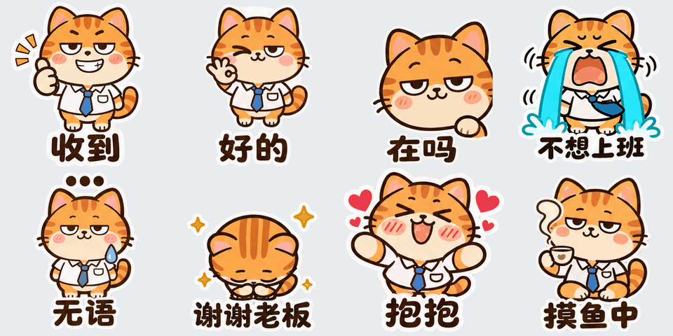

# 表情包工厂 zhineng-sticker

**用 GPT Image 2.6 批量做微信动态表情包，做完直接能上架、能接单。**

ChatGPT 的 GPT Image 2.6 已经能直接做 GIF 了，但一张一张在网页里做，形象容易跑、尺寸也不是微信要的。这个 skill 把剩下的活全包了：你说一句「帮我做一套打工猫表情包」，AI 帮你出角色、出 8 张动图、切成微信规格、检查一遍、连上架文案都写好。



<p>


</p>

上面这套「打工橘喵」就是用它做的：一张角色图 + 8 句话，出来 8 张 240×240 的 GIF，每张 230～340KB，全部符合微信表情开放平台的规范。

## 能做什么

- **选题库一键起套**：打工人、萌宠、情侣、长辈祝福 4 个主题，每个 16 句聊天高频话，动作都配好了
- **形象一致**：一张角色图锁定整套，每张都照它画
- **自动出微信要的全部素材**：240×240 GIF（自动压到 500KB 以内）、封面、聊天图标、横幅、赞赏引导图和致谢图
- **按微信规范自动检查**：尺寸、大小、字数、含义词重复、动作太像、敏感词，一条命令查完
- **批量**：多套一起合成、一起检查
- **上架文案和客户交付包**：接定制单直接把 zip 发给客户

## 怎么用

最省事的是 **Codex**（用 ChatGPT 账号登录就行，不用 API key，出图走你的 ChatGPT 额度）：

1. 装好 Codex（桌面版或命令行都行），用 ChatGPT 账号登录
2. 把下面这句话发给 Codex：

   ```
   帮我安装这个 skill：https://github.com/yunasuka/zhineng-sticker
   ```

3. 装好以后直接说：

   ```
   用 zhineng-sticker 帮我做一套打工人主题的表情包，角色是一只系领带的橘猫
   ```

   AI 会先给你看角色图和 8 句话，你确认了它再出整套。

**Claude Code** 也能用：把仓库放进 `~/.claude/skills/`，有 `OPENAI_API_KEY` 时它会调接口出图，没有的话它会把每张图的提示词给你，你去 ChatGPT 网页里出图、下载回来，后面的切图、检查、打包照样自动。

手动安装：

```bash
git clone https://github.com/yunasuka/zhineng-sticker ~/.codex/skills/zhineng-sticker    # Codex
git clone https://github.com/yunasuka/zhineng-sticker ~/.claude/skills/zhineng-sticker   # Claude Code
pip install pillow
```

## 做完以后怎么赚钱

| 方式 | 怎么做 | 说明 |
|---|---|---|
| 赞赏 | 上架时勾选「接受赞赏」 | 套数越多越好，祝福、打工人这类天天发的题材更容易收到赞赏 |
| 付费表情 | 有一套上架以后可以出付费款 | 一套 1 元，适合已有人气的角色出续作 |
| 定制接单 | 把作品发到闲鱼、小红书，接宠物、情侣、企业吉祥物的单 | 来钱最直接，商品页模板在 [custom-order.md](references/custom-order.md) |

详细的上架步骤看 [wechat.md](references/wechat.md)，三条路的真实数据和做法看 [money.md](references/money.md)。

## 注意

- 只做你有权使用的形象：自己的原创角色、自家宠物、本人。不做明星、动漫游戏角色和别人的画。
- 微信要求 AI 生成的内容如实声明，投稿时有相关选项就勾上。
- 过审和收入由微信和市场决定，本工具不保证。

## 搞不定？

装不上、出图报错、不知道怎么上架，关注微信公众号「**智能杠杆**」，后台留言，我们帮你解决。也接表情包代做。

## 致谢

本项目基于两个 MIT 开源项目修改：

- [ray-sticker-shop](https://github.com/imraywang/ray-sticker-shop)（Ray Wang）：出图、合成、检查流水线的基础
- [gif-factory](https://github.com/WoYun520/gif-factory)（WoYun520）：风格分类的思路，那边有上百个 GIF 样例

我们加了：选题库、Codex 内置出图、自动找格子空隙切图、白底自动抠图、批量处理、Windows 兼容、小白教程和变现手册。

MIT License
